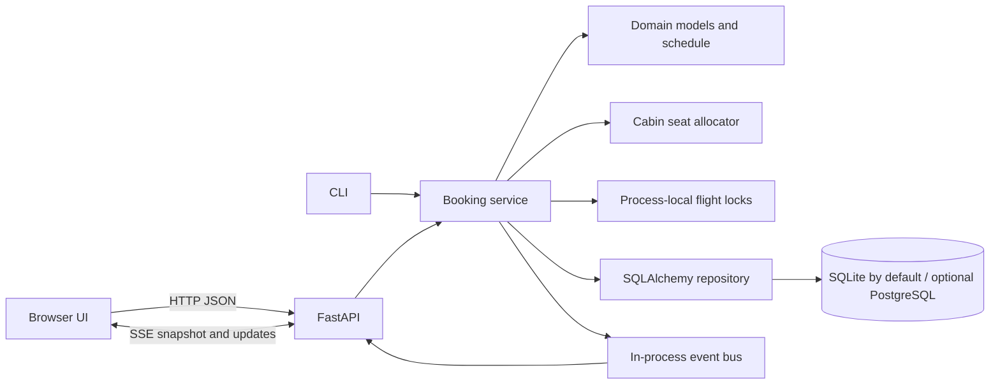

# AeroReserve implementation notes

This document describes the implementation in this repository. The service is a fictional academic demonstration; there is no airline inventory connection.

## Runtime components

- **Browser:** self-contained HTML, CSS and JavaScript under `src/aerobooking/web/index.html`; served from `/`. It calls relative `/api/...` URLs and uses native `EventSource` for SSE.
- **HTTP layer:** FastAPI/Pydantic validates HTTP payloads and maps domain errors to structured JSON. Blocking service and repository calls are moved to FastAPI's thread pool.
- **Domain/service:** immutable airport, flight, itinerary, passenger, quote and booking types; a fictional repeatable dated schedule; bounded itinerary search; pricing; reservation, cancellation and seat availability.
- **Repository:** SQLAlchemy models and transaction boundaries. The default engine is a local SQLite file; a `DATABASE_URL` may select a PostgreSQL engine using Psycopg 3.
- **Event bus and lock manager:** in-process facilities. They support the single-process demonstration and are not shared among Uvicorn workers or separate hosts.

## Schedule and search

There are 27 fictional daily flight templates over VGA, HYD, BLR, BOM, DEL, MAA and GOI. `flights_for_date(date)` materialises independent flight instances with IDs of the form `AS110-YYYY-MM-DD`. All schedule clock values represent Indian Standard Time. `india_today()` supplies date-range defaults and validation.

`FlightBookingService.search_itineraries` builds an outgoing-flight map for the selected date and performs a depth-bounded route walk. It stops at the requested destination, rejects airport cycles and never grows a path beyond `max_connections + 1` legs (one through three). At each transfer, the next departure must be at least 45 minutes after the previous arrival. Results are ordered by arrival timestamp, connection count, summed distance, then flight-ID tuple. Search is over this small fixed sample graph, not a live, cross-date airline schedule.

## Cabin seats and allocation

Each flight/cabin pair uses independent seat labels and a hand-authored sample layout:

| Cabin | Rows × seats per row | Seats |
|---|---:|---:|
| Economy | 6 × 6 | 36 |
| Premium Economy | 3 × 4 | 12 |
| Business | 2 × 4 | 8 |
| First | 1 × 4 | 4 |

`allocate_seats` filters occupied labels and applies one of three selectable policies:

1. **First-fit:** first free labels in row/column order.
2. **Window-first:** window seats first, then row/column order.
3. **Family-aware:** first contiguous same-row block that does not cross the aisle; if no such block exists, fall back to first-fit.

The seat-map API returns the cabin's labels, row/column, window marker and availability. A connecting itinerary has a separate seat assignment on each flight leg. This is not a passenger-selected seat checkout: the UI displays a preview and the server chooses at booking time.

## Fare model

Per-leg base charge is `distance_km × cabin_rate × passenger_count`. Cabin rates are ₹3.80, ₹5.50, ₹9.50 and ₹15.00 per km for Economy, Premium Economy, Business and First. The demo adds 5% to the subtotal as tax and ₹99 per passenger as a service fee. The values are visible in quote line items and are academic sample constants, not live fares or official tax calculations.

## Booking and cancellation sequence

1. Validate date, flight IDs, ordered airport joins, leg count, layovers, cabin, passenger count and allocation policy.
2. Acquire process-local flight locks in sorted flight-ID order, avoiding lock-order cycles for overlapping multi-leg itineraries.
3. Read occupied seats, allocate a set for each leg and re-check while those locks remain held.
4. Construct one PNR and a fare quote for the whole itinerary.
5. Insert the booking, all leg rows and a booking audit row in one SQLAlchemy transaction.
6. Release locks and publish one in-process SSE booking event per leg.
7. Cancellation serializes against booking for the same flight IDs in the process, changes the booking state to `CANCELLED` in a transaction, then publishes release events. Cancelled booking legs remain as audit/history rows; only confirmed bookings consume seats.

## Persistence shape

- `bookings`: PNR primary key, status, travel date, cabin, route, passenger JSON, fare JSON, timestamps.
- `booking_legs`: one ordered row per flight leg, with PNR foreign key, dated flight ID, route, times, cabin, seat-label JSON and distance.
- `audit_log`: append-style `BOOK` and `CANCEL` action, PNR, details and timestamp.

A flight inventory master table is not used: dated schedule instances are generated from the fictional schedule, and inventory is derived from active booking legs. The cabin layouts are code constants, not aircraft-specific external configuration.

## API and live updates

The REST interface supports airport listing, itinerary search, seat maps, fare quote, booking, PNR retrieval, cancellation, health and audit retrieval. `/api/flights/{flight_id}/events` subscribes before taking its initial snapshot, then sends event frames after confirmed booking/cancellation. Per-subscriber queues are bounded and replace their oldest pending event if full; clients refresh the authoritative seat map rather than treating the event as a durable event log.

## Concurrency and consistency boundary

`FlightLockManager` uses Python `RLock` objects held by one service process. Sorting IDs makes multi-leg lock acquisition deterministic. The repository transaction makes one booking write atomic **within that process's service flow**. The current schema stores a leg's seats in JSON and does not enforce cross-process `(flight_id, cabin, seat)` uniqueness; the lock manager itself is not shared. Therefore the threaded test supports a single-process concurrency claim only. Postgres transaction-level row locks, distributed locks or an authoritative seat-inventory row model plus multi-instance race tests are required before enabling multiple worker processes for booking.

The SSE bus is similarly in-process. A multi-worker deployment needs a broker (or another shared event mechanism) as well as consistent shared inventory locking. PostgreSQL URL support is provided, but its runtime behavior was not integration-tested in the project validation run.

## Validation suite

Pytest tests exercise route/layover bounds, cabin capacity and selection strategies, fare arithmetic, end-to-end booking and cancellation, API validation, event-bus delivery, live SSE over Uvicorn, Hypothesis properties and 50 concurrent booking threads competing for Economy seats on one flight. The race assertion reads active seat assignments from the repository after all requests complete. Tests use separate temporary SQLite database files. They do not prove multi-process or PostgreSQL concurrency correctness.
